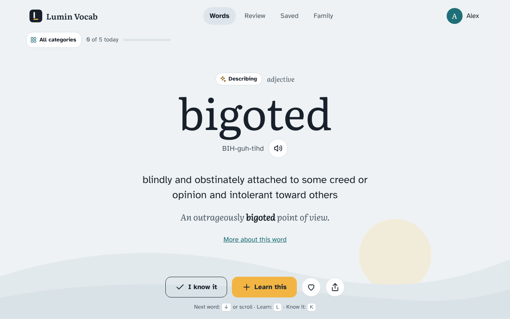

# Lumin Vocab

**A new word every day, for the whole family.** One calm word at a time, real spaced review that makes words stick, and levels from early readers to adults. Free, private, and open source.

Live at **[lumin.b7collective.com](https://lumin.b7collective.com)**. Made by [B7 Collective](https://b7collective.com).



## What it does

- **The word feed.** One word per screen with pronunciation, read aloud, a clear definition and an example. Swipe, scroll or use the arrow keys. Every action can be undone.
- **Review that works.** Words you choose to learn come back on a schedule set by an FSRS-based spaced repetition scheduler, through several kinds of practice: pick the meaning, pick the word, fill the blank, and spell it.
- **Four levels.** Sprout (ages 5 to 8) and Explorer (8 to 11) use definitions and examples written for kids. Scholar and Wordsmith draw on Open English WordNet. About 4,500 words in all, browsable by 17 categories such as Animals, Feelings, Nature and Science.
- **Family profiles.** Everyone gets their own level, words, theme and settings. Kids get simpler wording, bigger buttons and read aloud. An optional family PIN keeps grown-up settings and parent profiles locked.
- **Private family sync.** Turn it on, then add phones, tablets and computers with a QR code or a six-word family code. Everything is encrypted on the device before upload, so the server only ever stores ciphertext.
- **Unlimited history, favorites, collections, your own words, search, backups.**
- **Installs like an app** on iPhone, iPad, Android, Windows, Mac, Linux and ChromeOS, with install steps tailored to the exact device and browser. Works offline.
- No ads, no trackers, no accounts, no third-party scripts.

## How it's built

Plain HTML, CSS and JavaScript modules with no build step, served by a Cloudflare Worker with static assets. Sync uses a small API on the same Worker with a D1 database.

```
public/            the app (index.html, app.css, js/, data/words.json, fonts, icons, service worker)
src/worker.js      sync API: validation, rate limiting, stores encrypted blobs only
migrations/        D1 schema
tests/unit/        device detection, scheduler, encryption, server validation, word bank checks
tests/e2e/         Playwright tests on iPhone, Android, iPad and desktop, including two-device sync and the layout standard
tools/wordbank/    the scripts and kid word lists used to build words.json
```

### Layout standard

Every screen is built from one set of tokens and layout classes at the top of `public/app.css`: a spacing scale (4, 8, 12, 16, 24, 32, 48, 64), a type scale, three content widths and one side gutter. Buttons and chips never wrap their labels, headings balance their lines, paragraphs avoid one-word last lines, and a word on the card shrinks to fit rather than breaking. `tests/e2e/layout.spec.js` checks every screen on every device for sideways scrolling, off-screen content, wrapped labels and overlaps.

### Security

The page runs under a strict Content Security Policy (no inline scripts or styles, same-origin only). The sync API accepts JSON only, reads at most 1 MB per request, rate limits by network and by family, and caps each family's record count and stored size. Backups are validated on restore, and restoring one needs the family PIN. Repeated wrong PINs make the app wait before the next try.

### Sync and privacy design

From the six-word family code, each device derives (PBKDF2-SHA256, 210,000 iterations) an AES-GCM key, an HMAC key and a family id. Records are encrypted with AES-GCM, record ids are replaced by HMAC values, and the server stores only a SHA-256 hash of the family id. Conflicts resolve by last writer wins per record, with device id as the tie breaker. Every record carries a UUID-based id, a change timestamp, its originating device and a soft-delete flag.

## Run it locally

```sh
npm install
npm run db:local      # create the local database and apply migrations
npm run dev           # http://127.0.0.1:8787
npm test              # unit tests
npx playwright install chromium && npm run test:e2e
```

## Deploy

Pushes to `main` deploy automatically through Cloudflare Workers Builds. To deploy by hand: `npm run deploy`.

## Licenses

- **Code:** GNU Affero General Public License v3.0 only. See [LICENSE](LICENSE).
- **Word data** (`public/data/words.json`, `tools/wordbank/*.txt`): Creative Commons Attribution-ShareAlike 4.0. See [CREDITS.md](CREDITS.md) for sources and attribution.
- Fonts, the QR code library and other third-party parts keep their own licenses, listed in [CREDITS.md](CREDITS.md) and [LICENSES/](LICENSES).

Copyright (C) 2026 B7 Collective LLC.
